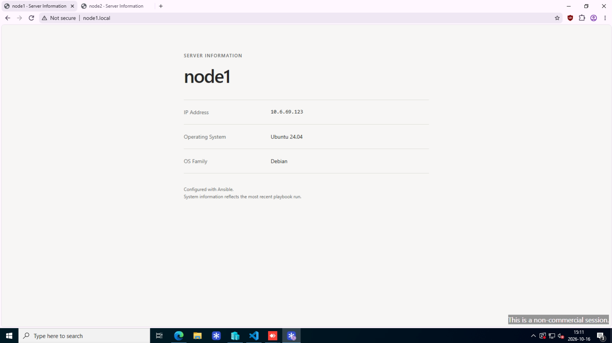
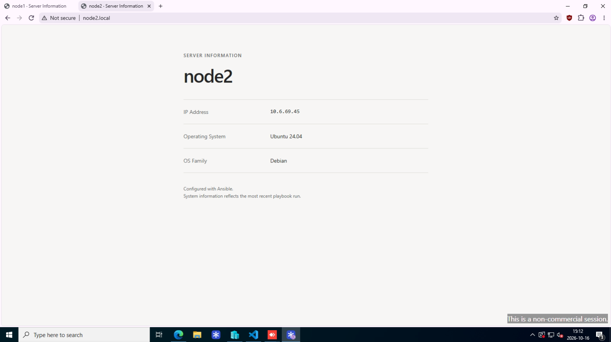

# Lab 6 – Dynamic Configuration with Jinja2 Templates

## Purpose

Use a Jinja2 template and Ansible Facts to generate a server information page for each managed node. Reuse the roles from Lab 5 and restart Nginx through a handler when its configuration changes.

## Environment

- **Control Node:** Ubuntu Server 24.04
- **Managed Nodes:** `node1.local` and `node2.local` (Ubuntu 24.04)
- **Automation Tool:** Ansible Core
- **Web Server:** Nginx
- **Authentication:** SSH key-based authentication as `troccaman`
- **Roles:** `common` and `webserver`, reused from Lab 5

All commands are run from `lab-06` on the control node.

## Task 1 – Project Structure and Configuration

The existing configuration, inventory, playbook, and roles were copied from Lab 5:

```bash
cd ~/ansible-configuration-management
mkdir -p lab-06
cp lab-05/ansible.cfg lab-05/inventory.ini lab-05/site.yml lab-06/
cp -r lab-05/roles lab-06/
cd lab-06
```

**`ansible.cfg`:**

```ini
[defaults]
inventory = inventory.ini
remote_user = troccaman
ask_become_pass = true
forks = 5
```

The local configuration defines the inventory and connection user, so `-i` is not required. Use `-K` to prompt for the sudo password.

**`inventory.ini`:**

```ini
[webservers]
node1.local ansible_user=troccaman
node2.local ansible_user=troccaman
```

**Relevant project structure** (unused role scaffold files omitted):

```text
lab-06/
├── ansible.cfg
├── inventory.ini
├── site.yml
├── README.md
├── images/
│   ├── node1-server-information.png
│   └── node2-server-information.png
└── roles/
    ├── common/
    │   └── tasks/
    │       └── main.yml
    └── webserver/
        ├── files/
        │   └── style.css
        ├── handlers/
        │   └── main.yml
        ├── tasks/
        │   └── main.yml
        └── templates/
            └── index.html.j2
```

The `common` role maintains user settings from Lab 4. The `webserver` role manages Nginx, the HTML template, and the stylesheet.

## Task 2 – Create the Jinja2 Template

**`roles/webserver/templates/index.html.j2`:**

```html
<!DOCTYPE html>
<html lang="en">
<head>
    <meta charset="UTF-8">
    <meta name="viewport" content="width=device-width, initial-scale=1">
    <title>{{ ansible_facts['hostname'] | e }} · Server Information</title>
    <link rel="stylesheet" href="/style.css">
</head>
<body>
    <main>
        <header>
            <p class="label">Server Information</p>
            <h1>{{ ansible_facts['hostname'] | e }}</h1>
        </header>

        <dl>
            <div class="row">
                <dt>IP Address</dt>
                <dd class="mono">
                    {{ ansible_facts['default_ipv4']['address'] | e }}
                </dd>
            </div>

            <div class="row">
                <dt>Operating System</dt>
                <dd>
                    {{ ansible_facts['distribution'] | e }}
                    {{ ansible_facts['distribution_version'] | e }}
                </dd>
            </div>

            <div class="row">
                <dt>OS Family</dt>
                <dd>{{ ansible_facts['os_family'] | e }}</dd>
            </div>
        </dl>

        <footer>
            Configured with Ansible.<br>
            System information reflects the most recent playbook run.
        </footer>
    </main>
</body>
</html>
```

Ansible gathers facts from each node at the start of the play. Jinja2 replaces the `{{ ... }}` expressions with that node's values before the rendered file is deployed.

For example, the same hostname expression becomes `<h1>node1</h1>` on `node1.local` and `<h1>node2</h1>` on `node2.local`. The browser receives ordinary HTML; it does not execute Jinja2.

The `| e` filter escapes values for HTML output. The IP address comes from the node's default IPv4 interface. Facts reflect the time of the playbook run rather than live updates in the browser.

The stylesheet is stored separately in `roles/webserver/files/style.css` and loaded through the HTML `<link>` element. It contains no Jinja2 expressions and can be copied unchanged.

## Task 3 – Deploy the Files with the Webserver Role

**`roles/webserver/tasks/main.yml`:**

```yaml
---
# tasks file for roles/webserver
- name: Install Nginx
  ansible.builtin.apt:
    name: nginx
    state: present
    update_cache: true
    cache_valid_time: 3600

- name: Configure default website
  ansible.builtin.copy:
    dest: /etc/nginx/sites-available/default
    owner: root
    group: root
    mode: '0644'
    content: |
      server {
          listen 80 default_server;
          listen [::]:80 default_server;

          server_name _;
          root /var/www/html;
          index index.html index.nginx-debian.html;
      }
  notify: Restart Nginx

- name: Copy stylesheet
  ansible.builtin.copy:
    src: style.css
    dest: /var/www/html/style.css
    owner: root
    group: root
    mode: '0644'

- name: Render server information page
  ansible.builtin.template:
    src: index.html.j2
    dest: /var/www/html/index.html
    owner: root
    group: root
    mode: '0644'

- name: Ensure Nginx is running and enabled
  ansible.builtin.service:
    name: nginx
    state: started
    enabled: true
```

The role installs Nginx, configures its document root, copies the stylesheet, and renders the HTML template. Within a role, `copy` finds its source in `files/`, while `template` finds its source in `templates/`.

Files are owned by root with mode `0644`, allowing Nginx to read them. The service is kept running and enabled at boot. Package cache validity is set to one hour to avoid unnecessary cache updates on repeated runs.

## Task 4 – Restart Nginx on Configuration Changes

**`roles/webserver/handlers/main.yml`:**

```yaml
---
# handlers file for roles/webserver
- name: Restart Nginx
  ansible.builtin.service:
    name: nginx
    state: restarted
```

The configuration task notifies this handler only when `/etc/nginx/sites-available/default` changes. The handler normally runs at the end of the play, applying the new configuration without restarting Nginx on unchanged runs.

Changes to HTML or CSS do not notify the handler because Nginx serves the updated content without a restart.

## Task 5 – Run the Main Playbook

**`site.yml`:**

```yaml
---
- name: Configure web servers
  hosts: webservers
  become: true

  roles:
    - common
    - webserver
```

Both roles run on the nodes in `webservers`. Privilege escalation is defined once in the playbook and applies to both roles. Fact gathering is enabled by default.

Validate and run:

```bash
ansible-playbook site.yml --syntax-check
ansible-playbook site.yml -K
```

## Task 6 – Browser Verification

Open both nodes in a browser:

- `http://node1.local`
- `http://node2.local`

The rendered pages displayed the following values:

| Hostname | IP Address | Operating System | OS Family |
|---|---|---|---|
| node1 | 10.6.69.123 | Ubuntu 24.04 | Debian |
| node2 | 10.6.69.45 | Ubuntu 24.04 | Debian |

These results show that a single template generated node-specific content and that both nodes served the HTML and stylesheet successfully.

**node1.local:**



**node2.local:**



## Task 7 – Verify Idempotency

Run the completed playbook again:

```bash
ansible-playbook site.yml -K
```

**Verified result:**

```text
PLAY RECAP
node1.local : ok=8 changed=0 unreachable=0 failed=0 skipped=0 rescued=0 ignored=0
node2.local : ok=8 changed=0 unreachable=0 failed=0 skipped=0 rescued=0 ignored=0
```

Both nodes already matched the desired state. No files changed, and the restart handler did not run.

## Conclusion

A single Jinja2 template generated server-specific HTML from Ansible Facts on both nodes. The webserver role deployed the page and stylesheet, maintained Nginx, and linked configuration changes to a restart handler. Browser verification confirmed the rendered values, and the completed playbook passed the idempotency check with zero changes and no failures.
