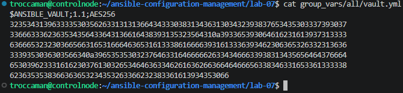
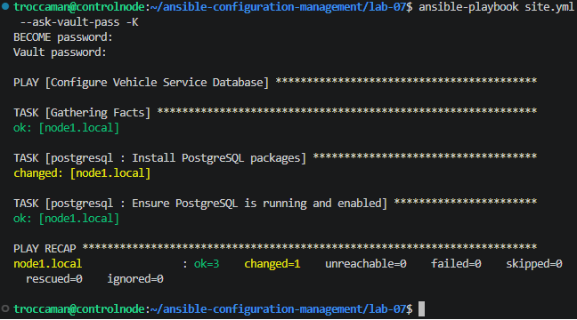
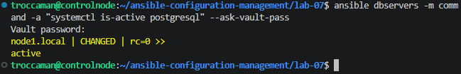
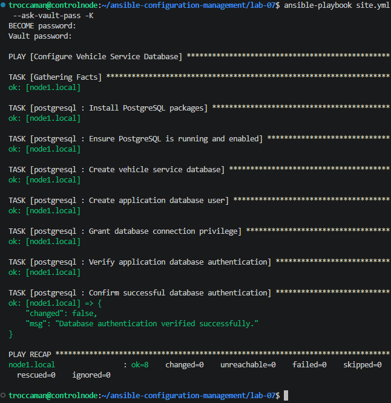
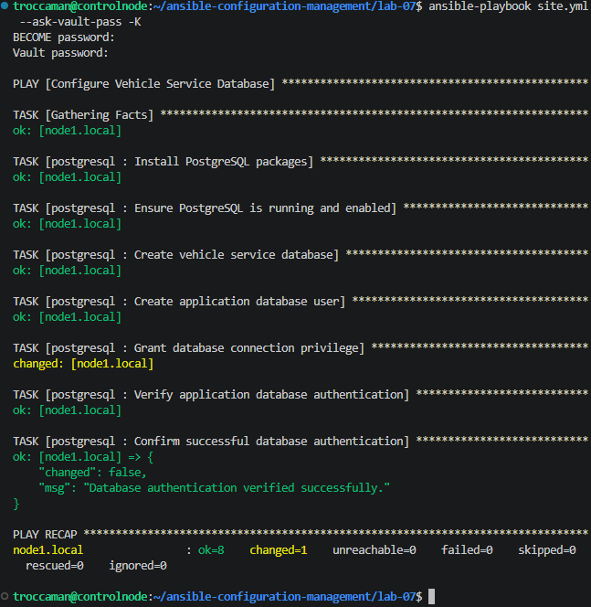

# Lab 7 – Secrets Management with Ansible Vault

## Purpose

Securely manage database credentials using Ansible Vault and automate PostgreSQL deployment for a vehicle service application.

The lab demonstrates encryption, reusable Ansible roles, database provisioning, least-privilege principles, idempotency, and configuration drift recovery.

## Environment

- **Control Node:** Ubuntu Server 24.04
- **Managed Node:** `node1.local` (Ubuntu Server 24.04)
- **Automation:** Ansible Core 2.16.3
- **Collection:** community.postgresql 3.3.0
- **Database:** PostgreSQL
- **Authentication:** SSH keys, sudo, and Ansible Vault

## Project Structure

```text
lab-07/
├── ansible.cfg
├── inventory.ini
├── site.yml
├── group_vars/all/
│   ├── vars.yml
│   └── vault.yml
├── roles/postgresql/
│   ├── defaults/main.yml
│   └── tasks/main.yml
└── screenshots/
```

## Task 1 – Ansible Vault

Created an encrypted variable file to protect the database password.

```bash
ansible-vault create group_vars/all/vault.yml
```

**vars.yml:**

```yaml
db_name: vehicle_service
db_user: service_app
db_password: "{{ vault_db_password }}"
```

The password is stored in `vault.yml`, encrypted with AES256 and excluded from plaintext source code.

**Verification:**

```bash
head -n 1 group_vars/all/vault.yml
```



## Task 2 – PostgreSQL Automation

Created a reusable Ansible role that:

- Installs PostgreSQL, python3-psycopg2, and acl.
- Ensures PostgreSQL is running and enabled.
- Creates the `vehicle_service` database.
- Creates the `service_app` user using the Vault password.
- Grants database connection privileges.
- Verifies database authentication automatically.

The application user has no PostgreSQL administrative privileges.

**Deploy:**

```bash
ansible-playbook site.yml --ask-vault-pass -K
```

**Verify PostgreSQL:**

```bash
ansible dbservers -m command -a "systemctl is-active postgresql" --ask-vault-pass
```





## Task 3 – Authentication and Idempotency

The playbook verifies database authentication using:

```sql
SELECT current_user;
```

An Ansible assertion confirms successful login as `service_app`.

**Result:**

```text
Database authentication verified successfully.
ok=8 changed=0 failed=0
```



Running the playbook repeatedly produces `changed=0`, confirming idempotency.

## Task 4 – Configuration Drift Recovery

Manually revoked the application's explicit CONNECT privilege:

```sql
REVOKE CONNECT ON DATABASE vehicle_service FROM service_app;
```

Re-ran the playbook. Ansible detected the missing privilege and restored it automatically.

**Result:**

```text
Grant database connection privilege: changed
ok=8 changed=1 failed=0
```



A final run confirmed `changed=0`.


*Note: PostgreSQL's PUBLIC role retained CONNECT access. The test demonstrates permission restoration, not recovery from a database outage.*

## Troubleshooting

**Issue 1 – Incorrect Package Name**

- **Problem:** `python-psycopg2` was unavailable.
- **Solution:** Replaced it with `python3-psycopg2`.

**Issue 2 – Privilege Escalation**

- **Problem:** Ansible failed when switching to the `postgres` Linux user because of temporary-file permission handling.
- **Solution:** Installed the `acl` package to support secure privilege escalation.

**Issue 3 – Missing Sudo Password**

- **Problem:** `Missing sudo password`.
- **Solution:** Added `-K` to prompt for the sudo password.

## Security Considerations

- Database credentials are encrypted using Ansible Vault.
- Vault decryption passwords are excluded from Git.
- Sensitive tasks use `no_log: true`.
- Database administration runs as the `postgres` system user.
- `service_app` has restricted administrative privileges.
- Credentials are verified without displaying the password.

**Security verification:**

```bash
grep -Rn --exclude=vault.yml 'sommar2024' . || echo "No plaintext password found"
git check-ignore -v group_vars/all/vault.yml
```

No plaintext password was found, and the encrypted Vault file was not ignored by Git.


## What I Learned

- Secure secrets management using Ansible Vault.
- Automated PostgreSQL provisioning with reusable roles.
- Database authentication and privilege management.
- Troubleshooting package and permission issues.
- Verifying idempotency and restoring configuration drift.

## Conclusion

Successfully automated secure PostgreSQL provisioning with Ansible Vault. The implementation demonstrates reusable configuration management, password protection, functional verification, idempotency, and automated recovery from configuration drift.