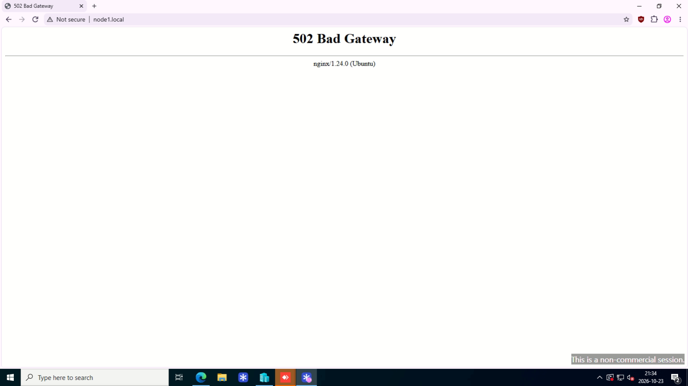
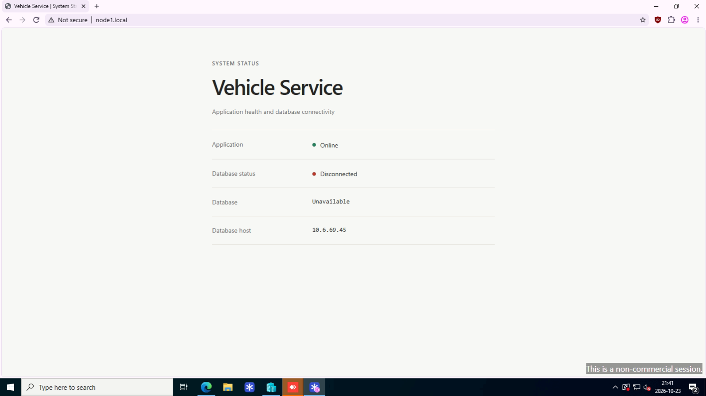

# Lab 10 – Multi-Tier Application Deployment

## Purpose

Automate the deployment of a multi-tier application using Ansible, Flask, Gunicorn, Nginx and PostgreSQL.

The lab demonstrates role-based configuration, dynamic database connectivity, systemd service management, Ansible Vault, idempotency and recovery from service interruptions.

## Environment

- **Control Node:** Ubuntu Server 24.04
- **Web Server:** `node1.local` (Ubuntu Server 24.04) – Flask, Gunicorn and Nginx
- **Database Server:** `node2.local` (Ubuntu Server 24.04) – PostgreSQL 16
- **Automation Tool:** Ansible Core 2.16.3
- **Authentication:** SSH key-based authentication and Ansible Vault

## Project Structure

```text
lab-10/
├── ansible.cfg
├── group_vars/
│   └── all/
│       └── vault.yml
├── inventory.ini
├── README.md
├── screenshots/
│   ├── 01-application-online.png
│   ├── 02-application-stopped-502.png
│   ├── 03-database-disconnected-503.png
├── roles/
│   ├── postgresql/
│   │   ├── handlers/main.yml
│   │   └── tasks/main.yml
│   └── webapp/
│       ├── files/
│       │   ├── index.html.j2
│       │   └── style.css
│       ├── handlers/main.yml
│       ├── tasks/main.yml
│       └── templates/
│           ├── app.py.j2
│           ├── nginx.conf.j2
│           └── vehicle-web.service.j2
└── site.yml
```

## Task 1 – Inventory and Ansible Configuration

**`inventory.ini`:**

```ini
[webservers]
node1.local

[dbservers]
node2.local
```

**`ansible.cfg`:**

```ini
[defaults]
inventory = inventory.ini
remote_user = troccaman
ask_become_pass = true
forks = 5
vault_password_file = ~/.ansible/lab10_vault_pass
```

The local Vault password file is kept outside the Git repository.

## Task 2 – Multi-Tier Playbook

**`site.yml`:**

```yaml
---
- name: Gather webserver facts
  hosts: webservers
  gather_facts: true
  tasks: []

- name: Configure PostgreSQL database
  hosts: dbservers
  become: true
  roles:
    - postgresql

- name: Configure web application
  hosts: webservers
  become: true
  roles:
    - webapp
```

The database is configured before the web application. Ansible facts provide the node addresses without hardcoding them in the Flask template.

## Task 3 – PostgreSQL Configuration

The `postgresql` role installs and starts PostgreSQL on `node2.local`, creates the `vehicle_service` database and `service_app` login, and grants database connection privileges.

Remote database access is restricted to the web node in `pg_hba.conf`, with SCRAM-SHA-256 authentication. The database password is stored in an encrypted **Ansible Vault** file.

## Task 4 – Flask, Gunicorn and Nginx

The `webapp` role installs the Python dependencies, deploys the Flask application and its HTML/CSS files, and configures Nginx as a reverse proxy.

**Application flow:**

```text
Browser → Nginx :80 → Gunicorn :8000 → Flask (node1.local)
                                            |
                                            v
                                    PostgreSQL :5432
                                       (node2.local)
```

Flask verifies access to the remote database with:

```sql
SELECT current_database(), current_user;
```

**`vehicle-web.service.j2` – service configuration:**

```ini
[Service]
User=www-data
Group=www-data
WorkingDirectory=/opt/vehicle-service
Environment=HOME=/tmp
EnvironmentFile=/etc/vehicle-service.env
ExecStart=/opt/vehicle-service/venv/bin/gunicorn --bind 127.0.0.1:8000 app:app
Restart=on-failure
```

Ansible manages both services using systemd. Handlers restart them when configuration changes.

## Task 5 – Deployment and Verification

Deploy the stack:

```bash
ansible-playbook site.yml -K
```

Verify the web application:

```bash
curl -i http://node1.local
```

**Verified result:** HTTP `200 OK`; the page reports `Application: Online`, `Database status: Connected`, `vehicle_service`, and database host `10.6.69.45`.


**Idempotency:** A subsequent playbook run made no changes:

```text
node1.local : ok=16 changed=0 unreachable=0 failed=0
node2.local : ok=8  changed=0 unreachable=0 failed=0
```

## Task 6 – Service Failure and Recovery

**Application interruption:** Stopped `vehicle-web` on Node 1. Nginx returned HTTP `502 Bad Gateway`, as the upstream application was unavailable.



Running `ansible-playbook site.yml -K` restored the service, and the application became accessible again.

**Database interruption:** Stopped PostgreSQL on Node 2. Flask remained reachable but returned HTTP `503 Service Unavailable`, with the database marked `Disconnected`.



Running the Ansible playbook restored PostgreSQL, and the application returned HTTP `200 OK` with the database status `Connected`.

Both recovery scenarios demonstrated how Ansible detects stopped services and restores the desired state when the playbook is executed.


## Conclusion

Successfully deployed and configured a multi-tier application using Ansible, Flask, Gunicorn, Nginx and PostgreSQL across two Ubuntu servers.

Ansible automated the installation, configuration and startup of both the web application and database services. By using separate roles, the deployment was structured and easier to maintain. Ansible facts and Jinja2 were used to automatically configure the database server address in the Flask application, reducing the need for manual configuration.

The application successfully connected to PostgreSQL and retrieved database information using SQL. Database credentials were secured with Ansible Vault, while systemd and handlers were used to manage services and configuration changes.

Idempotency was verified by running the playbook multiple times without unnecessary changes (`changed=0`). Service recovery was also tested by stopping Gunicorn and PostgreSQL separately, verifying the resulting errors, and restoring normal operation through Ansible.

Overall, the lab demonstrated how Configuration Management can automate a complete application deployment, manage dependencies between servers, and restore services after failures. It also provided practical experience in troubleshooting and maintaining a multi-tier environment.